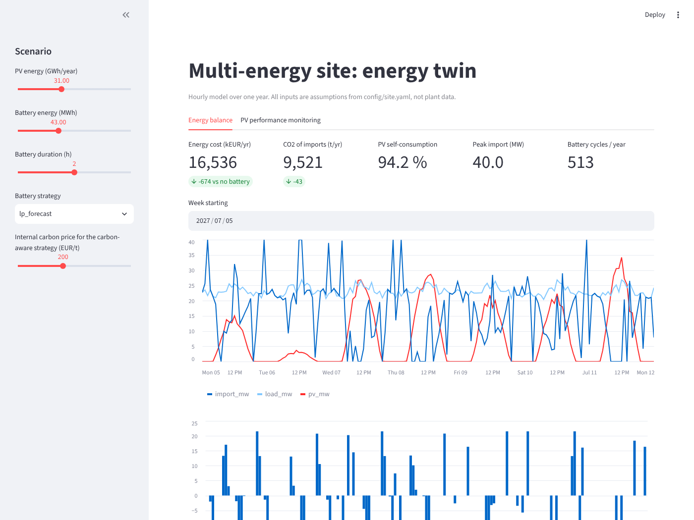
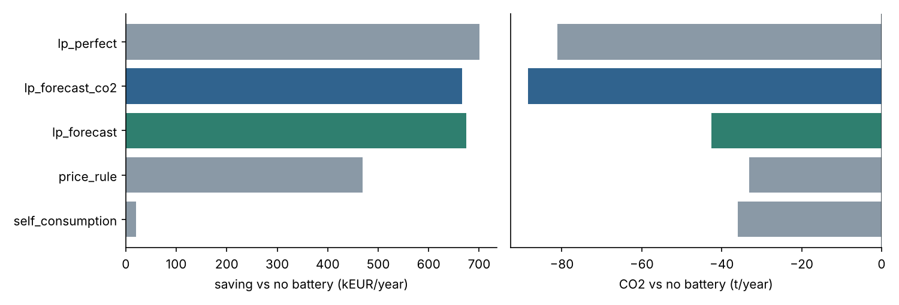
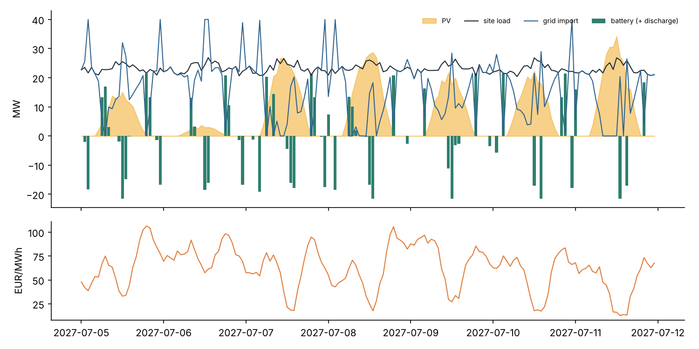
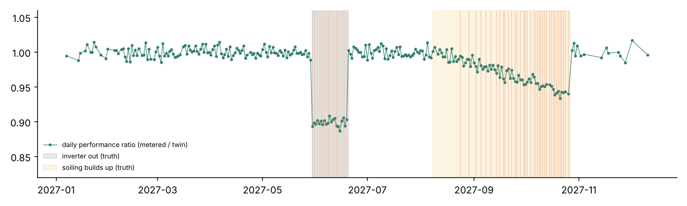

# Jumeau numérique énergétique d'une plateforme industrielle multi-énergies

[](https://github.com/Abderrahmane-BOULAMI/site-energy-twin/actions/workflows/tests.yml)

Une raffinerie reconvertie en plateforme bas carbone consomme beaucoup d'électricité, en produit une partie
(centrale solaire) et peut en stocker (batteries). Trois questions reviennent alors chaque jour : comment piloter
la batterie, combien cela rapporte en euros et en CO₂, et comment savoir vite que la centrale solaire produit moins
qu'elle ne devrait. Ce projet construit un **jumeau numérique énergétique heure par heure sur un an** pour y
répondre :

1. **Profils horaires** : production solaire (géométrie solaire et nébulosité), consommation des unités (arrêt
   programmé, déclenchements), prix de marché et contenu carbone du réseau.
2. **Six stratégies de pilotage de la batterie**, de « pas de batterie » à l'**optimisation par programmation
   linéaire** chaque jour, sur prévisions puis avec connaissance parfaite (borne haute), et une variante qui
   intègre un **prix interne du carbone**.
3. **Un bilan énergétique fermé à chaque heure**, vérifié par les tests : production, stockage, achats, ventes,
   écrêtement et limite du raccordement.
4. **Un jumeau de performance du solaire** qui compare la production comptée à la production attendue et détecte
   une panne d'onduleur et l'encrassement des panneaux.
5. **Un tableau de bord** (Streamlit) pour faire varier la taille de la batterie, la stratégie et le prix du carbone.

Les ordres de grandeur (31 GWh/an de solaire, 43 MWh de batteries, 22 MW de consommation) s'inspirent de données
publiques sur les plateformes reconverties ; ce sont des **hypothèses** réunies dans
[`config/site.yaml`](config/site.yaml), pas des données d'un site.



## Résultats

### 1. Piloter la batterie : l'optimisation rapporte, la règle intuitive presque rien

Coût annuel de l'électricité de 17,2 M€ sans batterie.

| Stratégie (batterie 43 MWh, 21,5 MW) | Économie (k€/an) | CO₂ (t/an) | Cycles par an | Pointe d'achat (MW) |
|---|---|---|---|---|
| Autoconsommation (stocker le surplus solaire) | 20 | -36 | 18 | 26,6 |
| Règle de prix (6 heures les moins chères / les plus chères) | 469 | -33 | 344 | 37,4 |
| **Programmation linéaire sur prévisions** | **674** | -43 | 513 | 40,0 |
| Programmation linéaire, prix carbone 200 €/t | 667 | **-88** | 509 | 40,0 |
| Programmation linéaire, connaissance parfaite (borne haute) | 700 | -81 | 524 | 40,0 |



- Le site consomme déjà 94 % de sa production solaire : stocker le surplus ne rapporte presque rien (20 k€/an).
  La valeur de la batterie vient de l'**arbitrage entre heures chères et heures bon marché**.
- Avec des prévisions simples (profil de la veille), l'optimisation obtient **96 % du gain** qu'aurait une
  connaissance parfaite.
- Un prix interne du carbone de 200 €/t **double la baisse de CO₂** (-88 t contre -43 t) pour 7 k€/an de gain en
  moins, soit environ 160 € par tonne évitée.
- Point d'attention : l'optimisation pousse les achats jusqu'à la limite du raccordement (40 MW contre 26,6 MW sans
  batterie). Le coût d'une puissance souscrite plus élevée n'est pas modélisé et pourrait réduire le gain.



### 2. Dimensionner la batterie : le gain marginal baisse au-delà de 43 MWh

| Batterie (MWh) | 10 | 21,5 | 43 | 64,5 | 86 |
|---|---|---|---|---|---|
| Économie (k€/an) | 167 | 356 | 674 | 893 | 1 063 |
| Gain marginal (k€/an par MWh ajouté) | 16,7 | 16,4 | 14,8 | 10,2 | 7,9 |

### 3. Surveiller le solaire : alerte le jour même pour un onduleur, en 16 jours pour l'encrassement

Le jumeau calcule chaque jour le **ratio de performance** (production comptée / production attendue). Deux défauts
sont injectés sans que le détecteur les connaisse : un bloc d'onduleur hors service pendant 3 semaines, puis un
encrassement qui monte jusqu'à 6 % avant le nettoyage programmé.

| | CUSUM sur le ratio de performance | Seuil fixe à 95 % |
|---|---|---|
| Onduleur hors service | détecté **le jour même** | |
| Encrassement | détecté après **16 jours**, à 1,2 % de perte | détecté après 62 jours |
| Fausses alarmes avant les défauts | 0 | |

Nettoyer 7 jours après l'alerte plutôt qu'à la date programmée ramène la perte due à l'encrassement de **148 MWh à
18 MWh** sur l'épisode.



## Limites

- Données simulées : profils, prix et contenu carbone sont générés ; les remplacer par les comptages et les prix
  réels ne change pas l'interface (mêmes colonnes).
- Pas de tarif de puissance souscrite ni de vieillissement détaillé de la batterie (seulement un coût de 5 €/MWh
  cyclé) ; avec plus de 500 cycles par an, la durée de vie des batteries est à vérifier.
- Pas de modélisation de l'hydrogène ni de la vapeur : seule l'électricité est bouclée.

## Lancer le projet

```bash
pip install -r requirements.txt
pytest -q                        # 9 tests
python experiments/run_all.py    # tableaux et figures de ce README (environ 10 s)
streamlit run app/dashboard.py
```

## Organisation

```
config/site.yaml        hypothèses du site (solaire, batterie, consommation, réseau)
setwin/profiles.py      profils horaires sur un an
setwin/dispatch.py      stratégies de pilotage, optimisation linéaire, bilan horaire, indicateurs
setwin/monitor.py       jumeau de performance du solaire et détection des pertes (CUSUM)
app/dashboard.py        tableau de bord
results/                chiffres et figures de ce README
```

Licence MIT.
